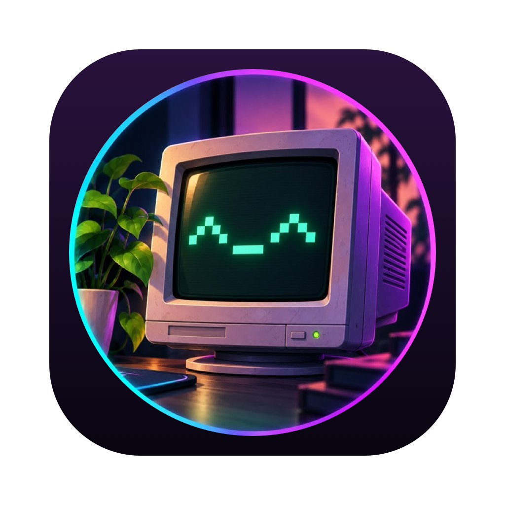

<p align="center">
  
</p>

<h1 align="center">MiniVNC</h1>

<p align="center">
  A tiny, native macOS VNC client for Linux and Windows desktops.<br>
  No toolbars, no settings window, no dependencies — just your remote screen.
</p>

<p align="center">
  <a href="https://github.com/Terminal-ennui/MiniVNC/actions/workflows/ci.yml"></a>
  <a href="https://github.com/Terminal-ennui/MiniVNC/releases/latest"></a>
  
  <a href="LICENSE"></a>
</p>

---

## Features

- **Saved connections** in a **Connections** menu and a menu bar icon — pick one and you're in.
- **Remembers passwords** in your macOS Keychain; you're only asked when none is saved or it stops working.
- **Fits your screen automatically.** On servers that support it (TigerVNC and other modern servers), the
  remote desktop resizes to match your window — go full screen and it matches your display. Otherwise
  the window takes the remote's shape and the picture scales smoothly.
- **Copy and paste both ways**, with full Unicode where the server supports the Extended Clipboard
  extension and Latin-1 otherwise. Items your password manager marks as concealed are never sent.
- **Feels like a Mac:** ⌘C / ⌘V / ⌘A work on the remote, the remote cursor is drawn locally, and
  trackpad scrolling is smooth.
- **Small and dependency-free:** the RFB protocol is implemented from scratch in Swift on top of
  Apple's frameworks and the system zlib. The whole app is about 2 MB.

## Install

1. Download `MiniVNC-<version>.zip` from the [latest release](https://github.com/Terminal-ennui/MiniVNC/releases/latest)
   and unzip it.
2. Move **MiniVNC.app** to your Applications folder.
3. The first time, **right-click the app and choose Open**. Releases are not notarized by Apple, so
   Gatekeeper asks once. (Alternatively: `xattr -dr com.apple.quarantine /Applications/MiniVNC.app`.)

The first connection to a machine on your network triggers macOS's **Local Network** permission
prompt — allow it, or MiniVNC can't reach LAN hosts.

## Usage

On first launch MiniVNC asks for a connection. Later, use **Connections ▸ New Connection…** (⌘N) or
the menu bar icon.

| You type | Connects to |
| --- | --- |
| `server` | port 5900 |
| `server:1` | display 1, i.e. port 5901 (numbers below 100 are display numbers) |
| `server:5905` | port 5905 |
| `server::22` | port 22, literally |
| `[2001:db8::1]:5901` | IPv6 (use brackets) |

**Connections ▸ Edit ▸ / Delete ▸** manage saved entries. **Send Ctrl-Alt-Delete** is there for
Windows logon screens, and **Disconnect** (⌘W) closes the window.

### Keyboard

| On the Mac | On the remote |
| --- | --- |
| ⌘ (Command) | Ctrl, so ⌘C, ⌘V, ⌘A, ⌘Z… behave as you'd expect |
| ⌃ (Control) | Ctrl |
| Left ⌥ (Option) | Alt, for shortcuts like Alt+F or Alt+Tab |
| Right ⌥ (Option) | AltGr-style: types the character your layout puts on ⌥, e.g. `@` on German keyboards |
| ⌘Q, ⌘W, ⌘H, ⌘M, ⌃⌘F | Stay with the Mac (quit, close, hide, minimize, full screen) |

### Window sizing

- **Server supports resizing** (it announces the ExtendedDesktopSize extension): resize the window or
  go full screen, and the remote desktop follows a moment later.
- **Server doesn't** (for example TightVNC): the window opens at the remote's size (shrunk to fit your
  screen), keeps its aspect ratio, and the image scales.

## Compatibility

Tested with TightVNC on Windows 11. It's built for servers such as TigerVNC, TightVNC, RealVNC and
x11vnc.

| | Supported |
| --- | --- |
| Protocol | RFB 3.3, 3.7, 3.8 |
| Security | None, VNC password |
| Encodings | ZRLE, CopyRect, Raw |
| Pseudo-encodings | Cursor, DesktopSize, ExtendedDesktopSize, LastRect, Extended Clipboard |

**Not supported:** macOS Screen Sharing / Apple Remote Desktop logins, VeNCrypt/TLS, Tight and
Hextile encodings, and file transfer.

> **Security note.** Classic VNC traffic is not encrypted, and VNC passwords are weak. Over anything
> but a trusted LAN, tunnel it through SSH:
>
> ```bash
> ssh -N -L 5901:localhost:5900 you@remote-host
> ```
>
> then connect MiniVNC to `localhost:1`.

## Build from source

Requirements: macOS 15 or later and Xcode 26 or later (Swift 6.2+).

```bash
git clone https://github.com/Terminal-ennui/MiniVNC.git
cd MiniVNC
swift test                 # run the test suite
./scripts/build-app.sh     # build build/MiniVNC.app
open build/MiniVNC.app
```

`build-app.sh` signs the app with your first "Apple Development" identity if you have one (that keeps
Keychain access approvals across rebuilds), or ad-hoc otherwise. Override it with `SIGN_IDENTITY=…`.

### Project layout

```
Sources/VNCCore/   The RFB protocol: transport, handshake, session, ZRLE decoder,
                   framebuffer, clipboard, key mapping, saved connections, Keychain
Sources/MiniVNC/   The AppKit app: menus, connection editor, viewer window, input
Tests/             Swift Testing suites for VNCCore, including a scripted fake server
scripts/           build-app.sh — builds and signs the .app bundle
```

## Releases

Pushing a tag like `v1.2.3` runs the [Release workflow](.github/workflows/release.yml): it tests,
builds the app with that version, and publishes a GitHub release with the zipped app attached. Every
push and pull request also runs [CI](.github/workflows/ci.yml).

## License

[MIT](LICENSE)
